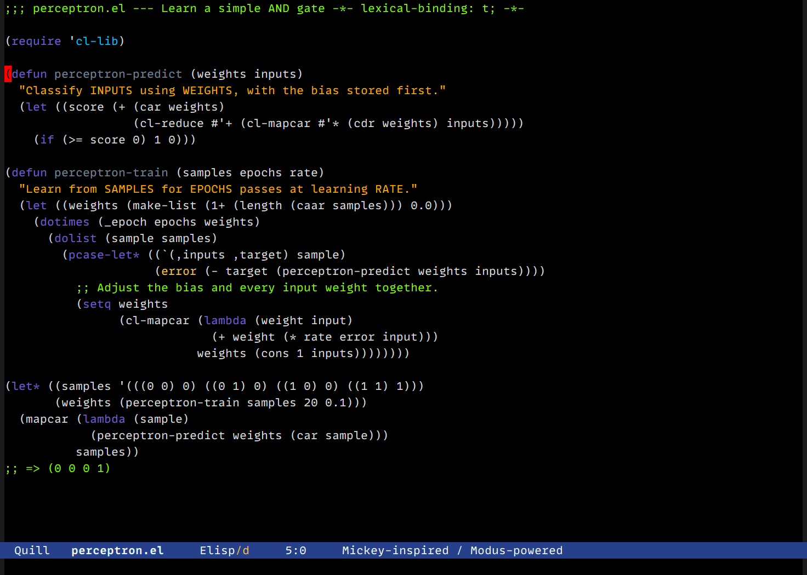

# Quill

A dark Emacs theme inspired by **[Mickey Petersen](https://github.com/mickeynp)**
and the personal colour scheme shown throughout **[Mastering Emacs](https://www.masteringemacs.org/)**.

Black background. Violet keywords. Orange-red strings. Lawn-green comments.
A red cursor and a royal-blue mode line.
Org code blocks and their begin/end lines share the black buffer background.
By default, fringes and inactive mode lines are black, with thin grey separators
and a line above each mode line. The original Mickey-inspired UI is an alternative.


Preview font: **MonoLisa Variable**, 12 pt ([render verification](docs/preview-font.txt)).
The font is not bundled with the theme.
Example code: [a perceptron learning an AND gate](examples/perceptron.el).

The name **Quill** honours Mickey's work as a writer and teacher. This is an
**unofficial, independently implemented theme**, not Mickey's configuration or
an endorsed Mastering Emacs product. Mickey is credited for the visual inspiration;
Harry Berg maintains this package. The face implementation comes from
[Modus Themes by Protesilaos Stavrou](https://protesilaos.com/emacs/modus-themes).

## Requirements

- Emacs **29.1 or later** (the derivative-theme interface uses theme properties
  that do not work correctly in Emacs 28).
- Modus Themes **5.2.0 or later**. Older bundled versions are insufficient;
  install or upgrade `modus-themes` from GNU ELPA and restart Emacs if needed.

Quill uses Modus's supported derivative-theme interface. It inherits broad face
coverage for Org, Magit, Dired, completion, diffs, diagnostics, and other packages.
These interfaces are not all reconstructed from Mickey's configuration: see
[the evidence and design notes](SOURCES.md).

## Install

First, use `M-x package-install RET modus-themes RET` to install Modus from
GNU ELPA (upgrade if an older package is already installed). This also registers
the dependency with `package.el`: bundled theme libraries are not always
recognized as installed packages. Then choose one installation method.

### From GitHub (Emacs 29+)

Evaluate:

```elisp
(package-vc-install "https://github.com/harryrberg/quill-theme")
```

Then put this in your init file:

```elisp
(load-theme 'quill t)
```

### Single-file package (Emacs 29+)

Download [`quill-theme.el`](quill-theme.el), run `M-x package-install-file`,
select the file, and then run `M-x load-theme RET quill RET`.

### Local checkout

```elisp
(add-to-list 'custom-theme-load-path "/path/to/quill-theme/")
(load-theme 'quill t)
```

For a clean comparison, disable your previous themes first with
`M-x disable-theme`. Existing Customize face settings can also override themes.
Quill does not disable other themes automatically or change your font, key bindings,
cursor shape, line numbers, or editor behaviour.

## Customize

### Minimal UI (default)

`M-x quill-toggle-minimal-ui` switches between the original UI and black
fringes/inactive mode lines. The active mode line stays blue, inactive text
remains readable, and window separator lines stay visible. The variant also
draws a thin grey line above both mode lines. The command changes this session
only and does not activate Quill if you are using another theme.

For Customize, run `M-x customize-group RET quill-theme RET`, set
**Quill Minimal Ui** to on (default) or off (Mickey-inspired alternative), and choose **Apply** for this session or
**Apply and Save** to persist it. Changes apply immediately when Quill is active.
You can also use `M-x customize-option RET quill-minimal-ui RET` directly.

For an init file (or an `init.org` source block):

```elisp
(setq quill-minimal-ui t)
(load-theme 'quill t)
```

The theme changes separator colours, not window geometry. For the thinnest
GUI separators, add the following. In Customize, the equivalent options are
under `M-x customize-group RET window-divider RET`.

```elisp
(setq window-divider-default-right-width 1
      window-divider-default-bottom-width 1
      window-divider-default-places t)
(window-divider-mode 1)
```

These are one-pixel separators between **Emacs windows inside a frame**.
Operating-system borders between separate application frames are outside the
theme's control. Explicit palette overrides take precedence over the preset.
If your `custom-file` is `null-device`, Customize cannot persist settings;
put them in `init.org` and tangle instead.

### Mickey-inspired alternative



Turn **Quill Minimal Ui** off in Customize, use `M-x quill-toggle-minimal-ui`,
or set the option before loading:

```elisp
(setq quill-minimal-ui nil)
(load-theme 'quill t)
```

This restores the original grey fringes and grey inactive mode line and removes
the mode-line overlines. Syntax colours are shared by both variants. This is
still our unofficial reconstruction, not Mickey's own distributed theme.

### Palette overrides

Quill follows Modus styling options. Its own palette overrides take precedence
over `modus-themes-common-palette-overrides`. Set overrides before loading,
or reload after changing them:

```elisp
(setq quill-palette-overrides
      '((keyword "#9580ff")       ; Brighter than the source screenshots.
        (bg-region "#203060")))
(load-theme 'quill t)
```

To return to the reconstructed palette, set `quill-palette-overrides` to `nil`
and reload. You can inspect the palette with `M-x modus-themes-list-colors`
and choose `quill` after loading it.

Quill prioritizes resemblance to the source screenshots. **It does not claim
Modus's WCAG AAA contrast guarantees**, particularly for the violet keywords
and the saturated blue selection. GUI/true-colour displays give the intended
result; limited-colour terminals approximate the palette.

## Evidence

The initial survey covered **114 articles** found through the site's article
index and sitemap, with **113 unique uploaded image assets**: 22 SVGs, 20 PNGs,
28 animated GIFs, and 43 editorial JPEGs. All were inspected in contact sheets;
selected references were also examined at full size. SVG fills and lossless
PNG pixels establish the principal colour values. GIFs were sampled at their
first, middle, and last frames for colour analysis; this was not a frame-by-frame
review of every animation.

The 2014 *Emacs Chat* interview with Mickey was also sampled at 18 timestamps.
It corroborates the long-standing visual style. This does not establish coverage
of every video featuring Mickey elsewhere on the internet.

See [SOURCES.md](SOURCES.md) for role-by-role provenance and
[docs/source-inventory.json](docs/source-inventory.json) for the complete URL inventory.
Source screenshots and recordings are linked, not redistributed. The preview
above is generated by this package from original example code.

## Development

With the required Modus version available:

```sh
emacs -Q --batch -L /path/to/modus-themes -L . \
  -l test/quill-theme-tests.el -f ert-run-tests-batch-and-exit
emacs -Q --batch -L /path/to/modus-themes -L . \
  --eval '(setq byte-compile-error-on-warn t)' \
  -f batch-byte-compile quill-theme.el
```

When Emacs bundles Modus 5.2+, omit `-L /path/to/modus-themes`.
The tests exercise loading/disabling/reloading, palette resolution and overrides,
upstream palette isolation, face coverage, and package metadata.

`tools/preview.el` creates both single-window perceptron previews in a separate Windows Emacs 31 GUI process
using `w32-export-frame`, then exits. It does not load your init file.
`tools/research.py` refreshes the local source cache using Python, requests,
BeautifulSoup4 and Pillow; `tools/render-references.py` renders cached SVGs
with Playwright and Edge. Downloads stay in ignored `.research/`.

## License and credits

The package code is licensed under **GPL-3.0-or-later**; see [COPYING](COPYING).
Modus Themes retains its own authorship and licensing. The package license
does not cover the linked Mastering Emacs articles, images, or external recordings.

- **Mickey Petersen** — original visual inspiration, Mastering Emacs, and Combobulate.
- **Protesilaos Stavrou and Modus contributors** — theme infrastructure and face coverage.
- **Sacha Chua** — the 2014 Emacs Chat interview and transcript.
- **Harry Berg** — this independent reconstruction and package.
